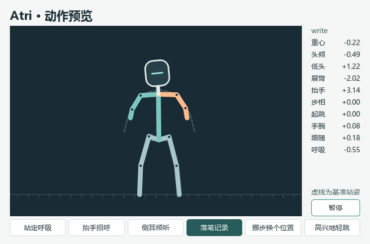

# Atri Desktop · 桌面亚托莉

你在看一道数学题时，亚托莉会先望过去，走到文字旁边，再停下来陪你看。晚上翻开她的日记，里面可能有今天聊到的那件小事，也可能只有安安静静待在一起的几句话。

这是 **lounthinker** 发起的 Windows 桌面陪伴项目，灵感来自《ATRI -My Dear Moments-》。我想做一个生活在电脑里的亚托莉：她带着原作里的性格来到桌面，也在一次次相处里慢慢认识你。

**下载后就能看到她。** 安装 Python 依赖后可以直接启动白裙亚托莉。四套桌面场景、身体动作、手写日记界面和 56 枚贴纸都随仓库提供。聊天和日记写作使用你自己的 Codex 登录，日语合成需要另外配置通用模型和获得授权的参考录音。[本地配置](docs/local-setup.md) · [已知问题与路线图](#已知问题与路线图)

公开版桌面实帧。游戏图像 © Aniplex Inc. All rights reserved.

## 她现在会做什么

| 在桌面上 | 你能看到什么 |
| --- | --- |
| 注意到你在做的事 | 她能识别前台窗口里的一部分学习、写作和编程内容，先看向相关文字，再选择旁边能站的位置。Windows 报告外部音频正在播放时，她也可能停下来侧耳听。 |
| 自己找事做 | 她有 43 种身体动作，调度器编排了 14 组日常活动。她会散步、翻日记、低头写字，也会就地休息。你中途按住她可以直接拖走，松手后再站稳。 |
| 把一次聊天记到下次 | 同一个角色会话会在重启后续接。通过本机已登录的 Codex，她可以聊起你以前告诉她的事。聊天窗口支持查看历史、排队和重试。 |
| 写自己的日记 | 她从当天实际记录过的经历和对话中选材，用自己的口吻续写，旧段落会保留。读本可以按日期翻阅，有手写体、按内容选的贴纸，也能用日语朗读当前这一篇。 |
| 开口说日语 | 文字可以显示中文，声音使用日语。嘴形跟随实际播放进度，说话前会先听或看向读本，说完再合嘴。静音后仍可文字交流。 |
| 随时间换一片风景 | 白色水手领连衣裙配半透明的教室、海边、灯塔或花海。场景有清晨、黄昏、蓝调和夜间光照，也可以关闭背景。 |

## 在 Windows 桌面见到她

准备 64 位 Windows 和 64 位 Python 3.11 或以上版本，在 PowerShell 运行下面的命令。也可以下载 ZIP，解压后在项目目录从创建虚拟环境那一行开始。[下载项目 ZIP](https://github.com/lounthinker-hash/Atri-Desktop/archive/refs/heads/main.zip)

~~~powershell
git clone https://github.com/lounthinker-hash/Atri-Desktop.git
cd Atri-Desktop
py -3 -m venv .venv
.\.venv\Scripts\python.exe -m pip install -r requirements.txt
.\.venv\Scripts\python.exe tools/check_local_setup.py --desktop
.\.venv\Scripts\python.exe desktop_atri.pyw
~~~

右键亚托莉，选「试演身体动作」可以看她走路和收势，选「立即演示一次日常活动」可以看调度器安排她做什么。菜单里也能聊天、翻日记、切换背景、静音和退出。Windows OCR 和原生渲染组件随仓库提供，想自行编译可以按本地指南操作。[本地配置](docs/local-setup.md) · [配置日语声音](docs/voice-models.md) · [下载离线语音模型分卷](https://github.com/lounthinker-hash/Atri-Desktop/releases/tag/voice-models-2026-11)

### 和她聊两句

在桌面右键选择「和亚托莉聊天」。如果想单独调试记忆和日记，也可以用下面的文字入口。先在本机登录 Codex，连续运行两条命令，她会依据刚才的交谈写下今天的记录。

~~~powershell
.\.venv\Scripts\python.exe examples/text_companion.py chat "路过花店时，我看到一整排向日葵。"
.\.venv\Scripts\python.exe examples/text_companion.py diary
~~~

文字示例使用独立存档，后续通过同一入口聊天会续上这段相处。首次运行时日记本是空的。

### 调一段动作

动作预览器可以把人物显示为几何关节，方便观察脚底何时着地、手腕何时停住。用它连续切换两个动作，可以对照关节参数找出衔接突变的那一帧。[身体动作设计笔记](docs/motion-design.md)

~~~powershell
.\.venv\Scripts\python.exe examples/motion_viewer.py
~~~

## 已知问题与路线图

| 方向 | 目前会遇到的问题 | 欢迎一起解决 |
| --- | --- | --- |
| 身体动作 | **部分动态动作仍然怪异。** 横走到中段，脸和衣领有时仍朝向观众，双腿已经交叉。看单一姿势很难察觉，原速看走路、停步、转身的衔接更明显。写字时也收到过书脊穿过手掌的反馈。 | 改善侧向和斜向的身体朝向、膝踝与重心，让最后一步自然接到站姿。在 150% 缩放的小号窗口检查鞋底、裙摆和停步前后几帧。 |
| 声音 | **语音和日记朗读偶尔会异常。** 点下后可能等很久才开口，也可能合成失败，需要重试。多段语音能连起来，但冷启动的首句等待仍然明显，日语重音和情绪也有不自然的时候。 | 缩短首声等待，改善分段、断句和轻声尾音。用同一句日语比较正常读完、半途打断和再次开口的效果。 |
| 屏幕识别 | 同页有多行相似内容时，她可能看错行，只移动高亮也可能没跟上。界面显示「待确认」或「未识别」时，她手头的线索还不够。 | 结合阅读位置和内容变化选择目标，处理短暂遮挡和多屏缩放，减少没必要的来回走动。 |
| 聊天与记忆 | 有时会接出一句和眼前情境不搭的话。长对话中，昨天的事、原作里的往事和你刚刚说的话，还需要分得更清楚。 | 用跨天对话检验她记住了什么、由谁告诉她。让措辞、表情和声音表达同一种情绪，日记也少一点重复。 |

## 数据在哪里

Windows 在本机识别前台窗口，桌面接收活动类别和候选文字的位置等信息。角色会话、聊天队列与日记保存在本机用户目录。聊天、写日记和准备日语读稿时，会调用已登录的 Codex，并发送该任务需要的文字与上下文。语音合成服务在本机运行。可以在角色右键菜单关闭屏幕感知或将声音静音。[本地配置](docs/local-setup.md)

## 一起来改

欢迎提 Issue，也欢迎直接发 PR。动作问题最有帮助的是一句能照做的描述，例如「小号、150% 缩放，向右走到第二步时，两膝挤在一起」。声音问题可以附一条可公开的日语测试句，并说明卡在准备、播放还是停止。识别或聊天问题可以用自拟的题目和对话复现。[提交反馈](https://github.com/lounthinker-hash/Atri-Desktop/issues/new/choose) · [查看 Pull Requests](https://github.com/lounthinker-hash/Atri-Desktop/pulls)

**项目作者与维护者：lounthinker** · [GitHub](https://github.com/lounthinker-hash) · [lounthinker@gmail.com](mailto:lounthinker@gmail.com)

本项目是非官方同人作品。原创代码按 MIT 授权。原作角色、美术、剧本、录音以及第三方模型由各自权利人持有。本仓库按原作的个人非营利使用条件展示游戏图片，并为字体、表情与模型分别保留上游许可。[MIT 许可证](LICENSE) · [素材与第三方署名](NOTICE.md) · [原作官网](https://atri-mdm.com/)
